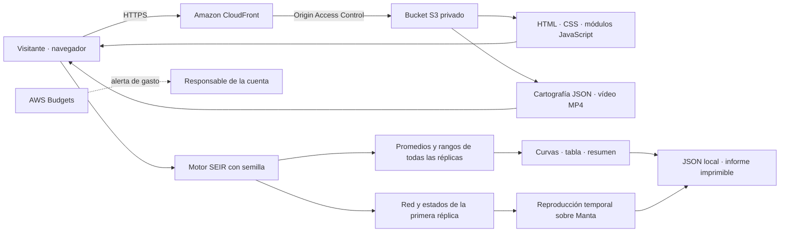

# Arquitectura de Natossi

NATOSSI es un sitio estático. La introducción cartográfica, el mapa y el motor de simulación se ejecutan en el navegador. La demo actual no necesita una API, Lambda, una base de datos ni credenciales de AWS en el cliente.

## Arquitectura propuesta para AWS

Publica el contenido de `dist/` en la raíz del bucket. CloudFront usa el endpoint REST de S3 con OAC y una política limitada a esa distribución. El bucket conserva el bloqueo de acceso público; el visitante accede a través de CloudFront.

Configura `index.html` como documento raíz y redirige HTTP a HTTPS. La navegación usa anclas en una sola página y no requiere reescrituras de rutas de una SPA. Conserva las rutas relativas, verifica tipos MIME de `.js`, `.json` y `.mp4`, y comprueba la búsqueda temporal del vídeo desde la distribución.

## Introducción y mapa

El vídeo satelital local de 24 segundos, organizado en cinco capítulos, avanza según la posición de scroll durante la introducción. La geografía procede del mismo recurso local de Manta que usa la interfaz, sin dependencia de un servidor de teselas durante la demo. Los datos y su atribución se documentan en [mapa-manta.md](mapa-manta.md).

Las imágenes de archivo proceden de Esri World Imagery y las vías de OpenStreetMap. La cartografía es real; las personas y contactos superpuestos son sintéticos. Las posiciones de los agentes son ilustrativas y no describen domicilios ni movilidad de personas reales. Al solicitar movimiento reducido, la introducción presenta un estado estático y evita el scrubbing y la reproducción automática.

## Flujo de simulación

1. El visitante elige escenario, recursos, eficacia, respuesta, estrategia, semilla y número de réplicas.
2. El motor construye una red sintética para cada réplica a partir de la semilla.
3. Las tres comparaciones reciben la misma red, estados iniciales y sorteos de contagio. La estrategia y el azar tienen el mismo presupuesto; la línea base no interviene.
4. En el día elegido se asignan dosis sólo a susceptibles. Cada dosis tiene la eficacia configurada y consume presupuesto incluso si no genera inmunidad.
5. Las curvas y tabla muestran medias, mientras los rangos muestran mínimos y máximos observados. El mapa reproduce únicamente la primera réplica, día a día, para la estrategia seleccionada.
6. El visitante puede aplicar un brote sorpresa y volver a comparar, descargar el JSON o imprimir el informe desde su navegador.

El JSON contiene la configuración y los resultados agregados, totales por réplica, la red y los estados diarios de la primera réplica. No se envían parámetros ni resultados a AWS o a terceros. La aplicación no implementa cuentas, almacenamiento remoto ni carga de archivos.

## Decisiones y límites

El hosting estático reduce los componentes operativos de la presentación. La reproducibilidad se obtiene con sorteos pseudoaleatorios indexados por semilla, persona y día. La cartografía local hace que el mapa no dependa de consultas a servicios de teselas en vivo.

El modelo conserva una población fija de 240 agentes durante 30 días y permite 12, 32 o 64 réplicas desde la interfaz. Las heurísticas son explicables, pero no garantizan la mejor decisión para todos los escenarios. La exposición dura dos días y la infección cuatro; la inmunidad adquirida se conserva durante el horizonte simulado. No hay calibración epidemiológica ni datos sanitarios reales.

Esta arquitectura es una propuesta. El despliegue AWS sigue pendiente y debe acreditarse con URL operativa, región, captura del Budget con alerta y gasto real de la cuenta después de crear y verificar los recursos.

## Publicación de la demo

El workflow de GitHub Pages publica el contenido estático de `dist/` después de comprobar el motor y la sintaxis de los módulos. Es una publicación de presentación independiente del despliegue AWS solicitado en las bases.

Las figuras sombreadas del mapa usan un atlas de sprites generado por canvas. Un bucle limitado a 60 fps se ejecuta sólo si el mapa está visible, la pestaña está activa y se permite el movimiento. El usuario puede pausarlo o acercarse al foco sin cambiar los estados del modelo.

## Reloj y entrega audiovisual

`playback.js` mantiene un reloj de presentación continuo con `requestAnimationFrame`. El día entero selecciona el estado de la réplica; la fracción controla el progreso visual. Pausar o salir de pantalla conserva la posición, y un fotograma retrasado no hace saltar varios días.

La entrega audiovisual sirve 1080p60 en escritorio y 720p60 en móvil. La secuencia se renderiza en Full HD nativo desde una imagen satelital de 4096 × 3352. La cadencia de 60 fps usa interpolación de los 24 fps originales; no equivale a una nueva captura de satélite. Los MP4 conservan keyframes frecuentes y metadatos al inicio para buscar posiciones al hacer scroll.
