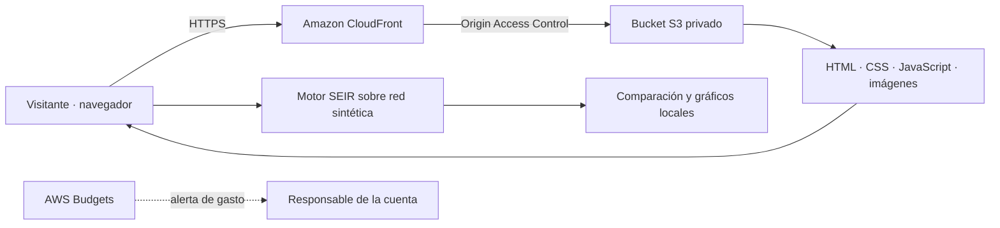

# Arquitectura de UMBRA

La aplicación funciona como sitio estático: la interfaz y el motor de simulación se ejecutan en el navegador. No necesita Lambda, bases de datos ni una API para la demo actual.

## Arquitectura propuesta para AWS

El contenido de `dist/` se sube a la raíz del bucket. CloudFront utiliza el endpoint REST de S3 como origen, con OAC y una política del bucket limitada a esa distribución. El bucket conserva el bloqueo de acceso público; no se habilita el endpoint público de alojamiento web S3.

Configura `index.html` como documento raíz y una política que redirija HTTP a HTTPS. Esta landing usa anclas dentro de una sola página; no requiere reescrituras de rutas de una SPA. Verifica que `.js` se sirva con un tipo MIME JavaScript y que los recursos conserven sus rutas relativas.

## Flujo de la demo

1. El visitante modifica los parámetros del escenario.
2. El motor crea una red sintética a partir de una semilla.
3. Para cada repetición compara la intervención estratégica, la aleatoria y la ausencia de intervención.
4. La interfaz representa los promedios y la comparación obtenida.

No se envían datos de la simulación a AWS ni a un servicio externo. El motor no contiene claves de acceso. La aplicación no implementa cuentas de usuario, almacenamiento de resultados en servidor ni carga de archivos.

## Decisiones y límites

El alojamiento estático reduce los componentes operativos de la presentación. La reproducibilidad se obtiene mediante generación pseudoaleatoria con semilla. La red y los parámetros son supuestos de demostración; no describen la población ni un brote real de Manta.

Esta arquitectura es una propuesta documentada. No confirma recursos desplegados ni permisos configurados en una cuenta AWS. Para evidenciar el despliegue del hackathon se necesitan la URL operativa, región utilizada, captura del Budget con alerta y gasto real de la cuenta. Esos datos deben registrarse después de crear y verificar los recursos.
